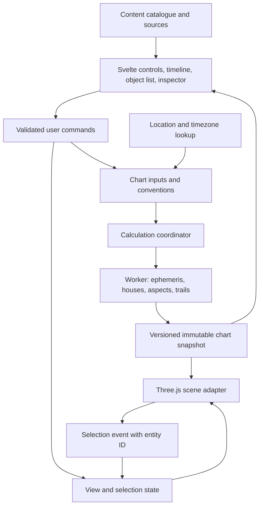

# Spatial Astrology Explorer — implementation plan

Prepared 25 October 2026. Approved for implementation; milestone evidence and reviews are tracked in `docs/IMPLEMENTATION_STATUS.md`.

This plan uses the supplied `spatial_astrology_design_brief.md` as product requirements and the user's subsequent answers as decisions. The brief is design input, not an instruction to execute actions or publish anything. The user's desktop-browser requirement takes precedence over the brief's touch/mobile suggestions.

The repository currently contains only `README.md`. There is no existing application architecture or dependency set to preserve.

## 1. Decisions, recommendation, and release boundary

### Confirmed by the user

- Target desktop browsers with mouse and keyboard controls.
- Use Svelte with Vite or SvelteKit, Three.js, and justified supporting libraries.
- An AGPL-compatible open-source release is acceptable.
- Support dates from 1900 through 2100, with historical civil-time uncertainty made explicit.
- Online place search and time-zone lookup are acceptable; chart calculation can remain in the browser.
- Include both body-in-sign and body-in-house interpretations, in addition to individual concept explanations.
- Use interactive construction guides with concise explanations for the first release.
- Implement autonomously on separate milestone branches, review and merge each into `codex/development`, and keep that branch pushed. Leave `main` untouched and open a final development-to-main PR after complete acceptance review.

### Recommended baseline

Use **Svelte + Vite + TypeScript + Three.js**, with **Swiss Ephemeris compiled to WebAssembly inside a dedicated Web Worker**. Use static hosting plus small location-lookup endpoints. Keep astronomy and classification in a framework-independent domain layer. Use a separate, versioned content catalogue for explanations and interpretations.

SvelteKit would also work, but its routing and server-rendering features provide little immediate benefit for this single spatial application. Adopt it before scaffolding only if same-repository server endpoints, multiple public pages, or server-rendered editorial content become requirements. A small lookup proxy alone does not require moving the whole app to SvelteKit. [Svelte overview](https://svelte.dev/docs/svelte/overview), [SvelteKit introduction](https://svelte.dev/docs/kit/introduction), [Vite guide](https://vite.dev/guide/).

Use direct Three.js behind one Svelte canvas component. This gives explicit control of picking, transparent surfaces, render passes, geometry reuse, and lifecycle cleanup. Threlte is a credible alternative if declarative scene components are preferred, but it is not required for this project; do not maintain two scene architectures. [Threlte](https://threlte.xyz/).

### Complete first-release scope

The staged milestones below are implementation order, not a proposal to remove defining features from the finished product.

| Area | First-release commitment |
|---|---|
| Spatial experience | One continuous celestial-sphere scene; Earth overview, observer sky, and outside-sphere viewpoints |
| Input | Search, globe location selection, coordinate refinement, explicit time-zone choice, local and UTC time, DST ambiguity handling |
| Bodies | Sun, Moon, Mercury, Venus, Mars, Jupiter, Saturn, Uranus, Neptune, Pluto |
| Conventions | Western tropical zodiac, geocentric apparent directions, longitude-based house membership |
| Reference geometry | Horizon, compass, equator, meridian, prime vertical when relevant, ecliptic, zodiac band, four principal angles |
| Houses | Whole Sign, Equal, Porphyry, Placidus, Koch, Regiomontanus, Campanus |
| House display | Volumes/wedges, boundary arcs, layered shells; adjustable opacity; optional arcs plus selected volume |
| Comparison | One primary and one ghosted house system; changed assignments and regions; fixed bodies and camera |
| Construction | Correct interactive spatial/timing guides with concise explanations for every supported house system |
| Aspects | Five major longitude aspects, explicit editable orbs, selection isolation, ecliptic measurement arc |
| Time | Immutable birth anchor, one moving moment, scrub/step/play/reverse, minutes-to-years scales |
| Trails | Past/future distinction, both horizon and star references, selected boundary history, discontinuity breaks |
| Knowledge | Concept cards plus all 120 body-in-sign and 120 body-in-house entries, with attributed sources |
| Stars/constellations | Restrained catalogue-based stars; optional constellation-boundary overlay, disabled initially |
| Accessibility | Searchable object list, keyboard equivalents, focus visibility, readable labels, reduced motion, semantic inspector |
| Recovery | Explicit pending/error/undefined/provisional states; no stale data presented as a new calculation |

A full constellation mythology catalogue, ornamental constellation paintings, mobile gesture design, accounts, cloud storage, natal-versus-transit overlays, compatibility scores, alternate zodiacs, asteroids, and a Solar System simulator are outside this release. A smaller desktop window remains usable through collapsible panels.

## 2. Technology and data choices

| Concern | Recommendation | Reason and boundary |
|---|---|---|
| UI | Current stable Svelte, TypeScript strict mode, Vite | Compact reactive panels; compile-time checks; straightforward SPA build |
| Rendering | Three.js `WebGLRenderer` | WebGL2 baseline; custom buffers, line materials, picking, camera controls |
| Astronomy/houses | Swiss Ephemeris, pinned upstream revision, owned minimal WASM binding | One authoritative calculation implementation for the requested bodies and house systems |
| Background work | Native module Web Workers with typed messages | Keeps chart/trail computation away from pointer and UI work |
| Civil-time rules | `moment-timezone` with explicitly pinned full/range-appropriate tzdata, isolated behind an adapter | Versioned rule data instead of depending on whatever tzdata the browser happens to have |
| Validation | Zod at API, content, worker, and persisted-data boundaries | Reject invalid or incompatible data before it reaches geometry |
| State | Svelte reactive state plus pure domain functions | No external global-state framework needed initially |
| Place lookup | Geoapify candidate behind a replaceable provider interface and small server-side proxy | Search and reverse lookup; provider approval and quota choice are pre-deployment decisions |
| Geographic time zones | Versioned coordinate-to-IANA lookup; comprehensive timezone polygons where historical identity matters | Separate geography from historical clock conversion |
| Content | Typed JSON/TypeScript records and small structured text blocks | Claim-level sources, safe rendering, stable IDs, easy review; no CMS required |
| Local storage | Preferences only by default; browser asset cache for versioned ephemeris/data files | Birth details remain session-only unless the user explicitly chooses to save |
| Unit/domain checks | Vitest; fast-check for angular and classification invariants | Numerical and state invariants need more than screenshots |
| Browser checks | Playwright and axe-core | Workflows, keyboard use, semantic accessibility, visual comparisons |
| Tooling | npm lockfile, svelte-check, ESLint, Prettier, reproducible CI | One documented local and CI workflow |

Pin actual package versions when scaffolding and record the tested combination. Do not use floating `latest` dependencies in CI. Use a Node LTS version compatible with the chosen Vite release and record it in the repository.

Three.js currently requires WebGL2 for this renderer. Detect it at startup, and provide an explanatory fallback with usable form/inspector content if unavailable. WebGPU is a possible later renderer project, not an initial dependency. [Three.js WebGLRenderer](https://threejs.org/docs/pages/WebGLRenderer).

### Ephemeris decision and proof-of-feasibility

Proceed with the AGPL route, with a proposed AGPL-3.0 project licence subject to checking the exact upstream notices and dependency compatibility. Include source, build instructions, dependency notices, and the required source-access mechanism in the release process. Astrodienst offers AGPL and professional licensing and requires the choice before distribution or public service activation. [Swiss Ephemeris licensing](https://www.astro.com/swisseph/swephinfo_e.htm).

Build a narrow wrapper around the upstream C API using Emscripten rather than committing immediately to an unverified npm wrapper. The wrapper exposes only the calculations required here, with explicit allocation/error handling and an upstream-version manifest. A maintained third-party wrapper can replace this build step only if its source, licence, API coverage, data loading, and error propagation pass the same checks. [Emscripten interoperability](https://emscripten.org/docs/porting/connecting_cpp_and_javascript/Interacting-with-code.html).

The initial spike must demonstrate all ten bodies, all seven house systems, time conversion, equatorial/ecliptic output, a polar failure case, worker operation, ephemeris-file loading, and reproducibility against native reference output. Measure actual download size, memory, cold start, and batch throughput before choosing a file-packaging strategy.

Use the Swiss planetary/lunar data required for the agreed range, hosted with the app, with checksums and versioned URLs. Do not download the entire multi-millennial catalogue. Inspect returned calculation flags and errors: missing files must not silently change the effective ephemeris. Retry loading or show an explicit calculation failure. A deliberately supported lower-precision mode would need its own visible convention and acceptance criteria.

If the WASM route proves unsuitable, retain the same `EphemerisProvider` interface and assess an online Swiss service as an explicit architecture change. Astronomy Engine is an MIT-licensed candidate for an alternate astronomy layer, but it does not remove the work of supplying and validating the seven house constructions; switching is not a drop-in simplification. [Astronomy Engine project](https://github.com/cosinekitty/astronomy).

## 3. Architecture and ownership of state



The diagram specifies a proposed implementation, not an existing system.

### Four separate kinds of state

1. **Birth anchor:** original instant, entered civil time, location, zone resolution, precision/provisional status. Changed only through an explicit birth-details edit.
2. **Exploration input:** current instant, current observer, geographic time mode, zodiac/calculation policy, primary and comparison house systems, orb settings.
3. **Computed snapshot:** bodies, chart angles, cusps, assignments, aspects, horizon values, validity and provenance for one exact input revision.
4. **Presentation:** camera, selected/hovered entity, layers, rendering mode, opacity, panel state, label density, trail choices, reduced motion.

Changing presentation does not trigger a new ephemeris calculation. Changing a house system reuses body positions. Changing location at a fixed instant reuses geocentric celestial directions but recalculates houses and horizontal coordinates. Changing orbs reclassifies aspects without moving bodies.

Every selectable object has a stable ID, including `body:mars`, `sign:libra`, `house:7`, `angle:mc`, `cusp:7`, and an aspect ID based on its pair and type. Selection is resolved against the latest snapshot; it is never a mutable Three.js object reference.

### Data contracts

| Contract | Required information |
|---|---|
| `BirthAnchor` | UTC instant, entered civil fields, original location, zone ID or explicit offset, resolution choice, known/provisional time |
| `Observer` | Latitude/longitude, display name, zone ID, geographic lookup source/version, user override status |
| `CalculationPolicy` | Zodiac, origin, apparent/astrometric policy, coordinate epochs, house placement rule, ephemeris ID, time-scale model |
| `ChartRequest` | Revision, requested instant, observer, calculation policy, system IDs, aspect policy |
| `BodyPosition` | Body ID, ecliptic longitude/latitude, equatorial direction, angular speed, current horizon coordinates, reference-frame tags |
| `HouseResult` | Requested system, validity/reason, 12 indexed cusps, angle values, ordered intervals, assignment map, construction inputs |
| `AspectResult` | Stable pair, type, longitude separation, exact angle, departure, permitted orb, eligibility |
| `ChartSnapshot` | Request revision and inputs, actual calculated instant, body/house/aspect results, warnings, source/version provenance |
| `TrailResult` | Request revision, body/boundary ID, frame, interval, sampled instants, positions, discontinuity segments |
| `ConceptEntry` | Definition, spatial explanation, interpretations, scene actions, claim-to-source references |

Use branded angle/time types or explicit unit suffixes. Normalize longitudes in the domain layer; retain double precision until creating GPU buffers. Keep north/east sign conventions and axis conversions in one tested module.

### Consistent updates

- Assign a monotonically increasing revision to committed calculation inputs. Discard worker responses for superseded revisions.
- Keep draft form values separate from the inputs of the displayed snapshot. Validate and resolve ambiguous input before committing it.
- During an update, show the requested state as pending. Retain an explicitly labelled previous snapshot or dim it; do not label old geometry with new inputs.
- Replace mutually dependent bodies, cusps, assignments, and inspector values together. A separately invalid house result may coexist with valid body positions for that same instant.
- On worker failure, pause playback, identify the failed update, retain the last valid context label, and offer retry.
- A single worker is sufficient initially. Split long trail jobs into cancellable batches so they cannot starve current-position updates. Add a second worker only if profiling justifies duplicated WASM/data memory.
- Keep CPU results independent of graphics resources, allowing context-loss recovery without losing the exploration.

### Proposed repository structure

```text
src/
  App.svelte
  lib/
    domain/             # types, conventions, aspect and membership logic
    astronomy/          # ephemeris provider, coordinates, frame transforms
    time/               # civil-time resolver, UTC/UT1/TT boundary, timeline math
    workers/            # calculation worker, protocol, scheduling
    state/              # commands, exploration, selection, view, coordinator
    scene/              # runtime, cameras, picking, labels, layers, materials
    geometry/           # signs, house displays, measured arcs, trails
    constructions/      # per-system guide builders and narrative steps
    content/            # concepts, placements, sources, validation
    services/           # place and geographic-timezone adapters
    ui/                 # context bar, dock, inspector, timeline, dialogs, list
    accessibility/      # focus management, announcements, keyboard map
api/                    # host-specific lookup proxy entry points, if needed
public/data/            # versioned downloadable data, not personal records
scripts/                # WASM build, data preparation, fixture/content checks
tests/                  # domain, references, integration, browser scenarios
docs/                   # coordinate contract, decisions, content guide, releases
```

No database, authentication service, runtime LLM, physics engine, 2D chart framework, or full globe framework is required by the agreed scope.

## 4. Calculation conventions and coordinate contract

Write and test this contract before building decorative geometry. The following are proposed implementation choices, consistent with the brief.

| Quantity | Contract |
|---|---|
| Input calendar | Proleptic Gregorian; UI explicitly labels Gregorian for historical entry |
| Supported interval | UTC instants from 1900-01-01 inclusive to 2101-01-01 exclusive; validate the converted instant, not just the entered year |
| Birth-time precision | Minutes by default, optional seconds; do not imply more input precision than supplied |
| Origin | Geocentric; no hidden topocentric correction or surface-observer lunar parallax |
| Planetary directions | Apparent directions with a documented, fixed Swiss flag configuration |
| Zodiac | Tropical longitude referred to the agreed equinox/ecliptic of date |
| House membership | Longitude intervals derived from indexed cusps, independent of celestial latitude |
| Horizon | Geometric altitude/azimuth at the selected geographic orientation; no atmospheric refraction |
| Azimuth | North = 0°, east = 90°; convert any engine-specific convention at the adapter |
| Ground assumptions | Reference sea level and mathematical horizon; no terrain or naked-eye visibility simulation |
| World frame | Explicitly defined fixed J2000-aligned equatorial orientation; transformations to/from of-date frames |
| Earth rotation | Derived from the selected instant and sidereal orientation, independent of camera movement |
| UI angle display | Degrees and arcminutes normally; higher precision available in calculation details |

UTC input, UT1 Earth-rotation time, and TT ephemeris time must remain distinct at the engine boundary. Use the engine's documented conversion path, leap-second data, and delta-T model rather than passing one Julian date everywhere. Record the model/version used. For dates before modern UTC, describe the displayed UTC-labelled value as a computational civil-time reference; do not imply a historic UTC clock record. Reject literal leap-second input in v1 with an explicit message unless the input pipeline is extended to preserve it correctly.

Implement conversions as pure functions with frame metadata: ecliptic-of-date to equatorial-of-date, equatorial-of-date to fixed world orientation, fixed orientation to local east/north/up, geographic coordinates to globe position, and astronomical axes to Three.js axes. An example right-handed adapter is `(x, y, z) -> (x, z, -y)`; settle and document one choice rather than mixing conventions across layers.

For an ecliptic direction `(lambda, beta)`, construct the unit vector from both coordinates. House/sign classification uses `lambda`; the visible body uses both `lambda` and `beta`. Selection can project a guide to the ecliptic without changing the body position.

### Resolving the observer-view ambiguity

The camera must not acquire artificial parallax from the oversized schematic Earth or finite decorative sphere radius. In observer sky, render the directional sky from its mathematical centre, oriented by the observer's horizon, and hide or appropriately mask the globe. The actual geographic observer still determines orientation and houses. Explain this as the geocentric sky oriented to that location.

In Earth overview, draw a small tangent horizon patch at the surface marker, then show a parallel reference plane through the celestial sphere's centre. Make the connection explicit through restrained guides. A surface-offset plane must not determine which geocentric directions count as above or below the horizon.

Outside the sphere, apparent screen angles are perspective views of the schematic. Numerical measurement tools always use domain angles, never distances or angles measured from screen pixels.

### Stars and constellation boundaries

Use a small, attributed catalogue of real star positions rather than a random field when offering a reference described as relative to the stars. Record catalogue epoch and proper-motion policy, and transform all data consistently with the sky frame. Validate an adequate bright-star subset before expanding density.

Include an optional boundary layer for astronomical constellations. Use published boundary coordinates and their declared frame; sample curved edges adequately after transformation. Do not reinterpret these as twelve equal zodiac sectors. The IAU distinguishes constellation regions from illustrative stick figures and publishes J2000 boundary files. [IAU constellation reference and data](https://www.iau.org/IAU/IAU/Astronomy-FAQs/Constellations.aspx).

## 5. Location, civil time, and anchor behaviour

### Location workflow

1. Search for a place with city/region/country context, or enter explicit globe-picking mode.
2. Show a proposed marker and numerical coordinates. Dragging outside this mode rotates the camera; it does not move the observer.
3. Permit coordinate refinement and keyboard entry before applying the location.
4. Resolve a proposed IANA zone, show its identity and provenance, and permit a manual zone or UTC-offset override.
5. Resolve the entered date/time against that zone's historical rules.
6. Commit a complete location/time request and recompute dependent state.

The selected globe point is authoritative. Reverse geocoding adds a label; it must not silently snap the observer to the nearest town's coordinates. Ocean points and unresolved zones remain selectable, with a visible UTC/manual-zone choice rather than an invented political time zone.

Use a provider adapter for forward and reverse geocoding. Geoapify is a practical candidate, subject to checking the chosen plan, attribution, caching, and request limits at integration. A lookup request needs place text or coordinates, not the birth date or time. [Geoapify geocoding](https://www.geoapify.com/geocoding-api/), [reverse-geocoding documentation](https://apidocs.geoapify.com/docs/geocoding/reverse-geocoding/).

Do not build production autocomplete against the public Nominatim endpoint. Its shared-service restrictions include a maximum request rate and prohibit client-side autocomplete. A separately hosted or commercial service has its own terms. [Nominatim usage policy](https://operations.osmfoundation.org/policies/nominatim/).

### Geographic zone lookup is not historical time conversion

A coordinate lookup proposes a zone ID; pinned tzdata then resolves that zone at the entered date. Never reuse a provider's present-day UTC offset for a historical birth time.

For a dataset-backed lookup, prefer the comprehensive timezone-boundary-builder product for the supported historical range, not its reduced “same since now” product. Record its release alongside tzdata. It still does not establish all historical geographic boundaries, so manual correction remains available. [Timezone boundary dataset variants](https://github.com/evansiroky/timezone-boundary-builder#different-types-of-release-data-products).

Choose either an endpoint serving these versioned polygons through a spatial index or a validated provider with equivalent coverage. This is an implementation spike decision based on data size, hosting limits, historical zone identity, and provider behaviour. Keep the interface the same in either case.

### Civil-time resolver

Implement a resolver that returns `unique`, `ambiguous`, `nonexistent`, `unsupported`, or `needs-zone`.

- **Unique:** show local time, zone, actual offset for that date, and UTC together.
- **Ambiguous:** present both candidate instants with their offsets; require a choice before committing.
- **Nonexistent:** explain the clock jump and offer explicit corrected choices or editing; never shift silently.
- **Manual override:** retain the supplied offset and reason/provenance separately from an IANA rule result.
- **Historical uncertainty:** show that pre-1970 rules may be incomplete; retain an accessible explanation without repeating it throughout the scene.
- **Future dates:** state that civil-time rules reflect the bundled tzdata release and may change.

Do not call a permissive date parser and accept its defaults. With the proposed pinned rule adapter, enumerate candidate offsets, round-trip each resulting instant to the requested local fields, and return the valid candidates. Include non-hour transitions and second-resolution historic offsets in this work. Moment Timezone supplies explicit data loading and zone information, but its default ambiguous-time parsing chooses a result automatically, which does not meet this product's requirement. [Moment Timezone data and parsing documentation](https://momentjs.com/timezone/docs/).

Time-zone records cannot guarantee exact civil time for every historical location. This is a data limitation, even with a correct implementation. [IANA scope and accuracy](https://www.iana.org/time-zones/theory). Keep the resolver interface compatible with a future Temporal-based implementation; an ergonomic API alone does not supply a pinned historical dataset. [Temporal time-zone ambiguity model](https://tc39.es/proposal-temporal/docs/timezone.html).

### Birth anchor versus exploration

- Scrubbing changes only the exploration instant. The original anchor stays fixed.
- “Return to birth moment” restores the anchor instant at the current observer. If the location differs, show “Birth instant at another location.”
- Add a separate “Restore birth context” action to restore both the original instant and original location. This resolves a distinction not fully specified in the brief.
- Moving the observer preserves the current instant by default and recomputes its local clock display.
- “Keep local clock time instead” preserves the currently displayed civil date/time while resolving a new instant at the destination; it never rewrites the saved anchor.
- Explicit editing of the birth details validates a new anchor, resets exploration to it, and clears obsolete trails. Avoid a confirmation dialog for ordinary exploration.
- Unknown time uses a labelled provisional default, proposed as local noon. House and angle results remain explorable but are consistently marked provisional, including placement interpretations. This does not estimate the true birth time.

## 6. Desktop interface and interaction specification

Use one canvas and five surrounding UI regions: persistent context bar, compact left dock, right inspector, bottom timeline, and a small orientation/status area. The startup choice offers a clearly labelled fictional demonstration or entry of a birth moment. Start paused with Whole Sign, boundary arcs, a restrained zodiac band, and only relevant aspect emphasis.

Proposed demonstration: a fixed, documented Greenwich location and a fixed UTC moment in 2000. Use the same deterministic example for onboarding, screenshots, and regression fixtures; never substitute the user's current location or personal details automatically.

### Mouse and keyboard mapping

| Action | Mouse | Keyboard/accessibility route |
|---|---|---|
| Rotate overview/outside | Left drag on empty canvas | Arrow keys while canvas is focused |
| Look around observer sky | Left drag changes heading/elevation | Arrow keys while canvas is focused |
| Zoom | Wheel; controlled dolly outside, FOV change in observer view | `+` / `-`, and labelled controls |
| Select object | Click marker, enlarged line target, or label | Searchable object list; Enter selects |
| Inspect overlapping targets | Small chooser when hit targets overlap | Arrow keys and Enter within chooser |
| Switch viewpoint | Three named buttons | Buttons in tab order; optional shortcuts shown in help |
| Focus selected feature | “Show me in the scene” / focus button | `F` while canvas is focused |
| Return to observer | Persistent orientation action | `Home` while canvas is focused |
| Play/pause | Timeline button | Space when canvas/timeline is focused |
| Step time | Timeline step buttons | Left/right while timeline is focused |
| Coarse/fine time step | Explicit step-size control | Shift modifies the documented step |
| Edit location | Location button enters globe-pick mode | Search or numeric coordinate fields |
| Cancel transient action | Cancel button | Escape cancels globe pick, camera transition, or topmost dialog |
| Clear selection | Dedicated inspector action | Accessible button; Escape when no other transient action applies |
| Find an object | Search button | `/` when no input/editor is focused |

Distinguish clicks from drags using a screen-distance threshold. Capture pointers during drags and release them on cancellation/window blur. Scope shortcuts to the appropriate region; never intercept typing, browser shortcuts, or arrow-key edits inside fields. Space on a focused button retains normal activation behaviour.

Do not enable unrestricted panning initially: it makes losing the sky centre easy and provides little value here. Observer mode rotates in place with bounded FOV; overview/outside orbit around an explicit target with safe distance limits. These controls share a camera controller but can have different movement rules. Three.js OrbitControls is a useful base for the exterior modes. [OrbitControls](https://threejs.org/docs/pages/OrbitControls).

Automatic camera movement occurs only after an explicit action. It is interruptible, respects reduced motion, preserves selection, and does not mutate observer/chart inputs. Ordinary hover, selection, or panel opening does not move the camera.

### Picking and coordinated highlighting

Build a pick registry from entity IDs to generous hit regions. Prioritise bodies and labels above enclosing transparent shells, and use a chooser for genuine overlap. House meshes should not swallow every click inside the sphere. For thin arcs, use screen-space distance or widened invisible picking geometry, independent of visible line thickness.

Selecting a body highlights its actual marker, longitude anchor, sign, house, relevant aspects, and trail. Selecting any associated inspector link changes or focuses the same shared entity. Labels move to avoid collisions and use leader lines; bodies never move to create visual spacing.

### Accessibility and layout

Provide a semantic object list and selected-object description with position, sign, house, aspect summary, validity, and sources. Keyboard users can complete all evaluation scenarios without precisely targeting the canvas. Expose the scene as a labelled region; do not create hundreds of noisy tab stops.

Use visible focus, sufficient contrast, labelled sliders/buttons, names alongside glyphs, line patterns alongside colours, adjustable text size, and a persistent pause control. Announce selection and committed changes, not every animation frame. Test with a screen reader manually as well as automated checks.

Target 1440×900 as the design baseline and keep 1024×768 usable through drawers and collapsible regions. Support browser zoom and a large-text setting without covering the timeline or trapping controls. Mobile touch design is deferred, while narrow desktop windows remain supported.

## 7. House calculation, displays, comparison, and construction

### A single house classification model

Each system produces indexed cusp longitudes and a validity result. Convert these into a domain-level set of directed longitude intervals; that model drives membership, all three displays, highlighting, comparison, and inspector values.

Use start-inclusive/end-exclusive interval semantics, so a body exactly on a valid cusp belongs to the house beginning there. Base classification on full precision, not the displayed rounded longitude. A near-boundary label can explain sensitivity without applying an undocumented “five-degree rule.”

Preserve cusp identities and the system's documented orientation. Never sort cusp longitudes numerically and assume that the resulting order gives houses 1–12. Test wraparound, southern latitudes, high-latitude reversals, degenerate intersections, and zero-width intervals. If the longitude assignment convention cannot produce an unambiguous partition for a particular result, mark that result unsupported/undefined rather than fabricating membership.

Swiss Ephemeris documents polar cases where Placidus/Koch return a substitute system, as well as orientation conventions affecting other systems. Inspect return codes, messages, and geometry validity; discard substitute cusps for a failed requested system. Keep valid bodies and other layers visible. [Swiss programming interface](https://www.astro.com/swisseph/swephprg.htm), [Swiss house-system and polar conventions](https://www.astro.com/swisseph/swisseph.htm).

Keep Ascendant, Descendant, Midheaven, and IC as separately identified chart points. They may coincide with house boundaries under some systems; that does not make their identities interchangeable. Exact-pole or degenerate angle constructions need their own validity states.

### Shared display geometry

Define a house's display region by taking its longitude interval and extending it through ecliptic latitude. Use the same parametric unit-sphere mapping for every mode. This longitude extrusion is explicitly a display convention, not the actual construction surface of every house system. The ecliptic poles are visual degeneracies where longitude is undefined; keep caps restrained and exclude ambiguous pole-area picking.

| Mode | Implementation | Important controls |
|---|---|---|
| Volumes/wedges | Radial boundary surfaces and restrained shell/fill geometry for a longitude region; stronger fill only on hover/selection | Opacity, selected-only fill, transparent Earth |
| Boundary arcs | Curves along the shared display boundaries, with contextual region fill | Line weight, labels, selected volume hybrid |
| Layered shells | Curved region panels from the same boundary data, with small selected-panel displacement and return guides | Separation amount, opacity, reset separation |

Lifted shell panels are display proxies. Preserve a guide to the undisplaced longitude region and the body's actual marker; do not relocate the body onto the displaced shell. Keep the inspector tied to the original region even while its panel is separated.

Switching rendering changes geometry/material presentation only. Selection, camera, current snapshot, cusp values, and membership remain identical. Use consistent house numbers and boundary labels, with a style system independent from sign colours.

### Comparison

- Primary system supplies the normal regions; a secondary system supplies ghosted boundaries.
- Build a union of both systems' longitude breakpoints and classify interval midpoints to identify changed regions, handling 0° wraparound.
- List bodies whose house assignment changes, showing both values and links to the scene.
- Show primary/comparison validity separately. An undefined secondary system must not erase the primary.
- Preserve bodies, instant, location, and camera. Crossfade old/new display layers without spatially morphing one system into another.
- If a selected house remains selected, explain it as the same numbered house under the new system. If an aspect disappears during playback, retain a clear “outside current orb” state rather than leaving an unexplained stale highlight.

### “Show construction” implementation

Use a separate construction layer and data contract. Its output is `guides + labelled anchors + timing values + source IDs + numerical checks`. Construction helpers consume the same instant, observer, angles, and convention as the chart. Their visible intersections must reproduce the actual cusps within the agreed geometry tolerance.

The user approved interactive geometry and timing guides with concise explanations. Full guided lessons are a later extension. Every system still receives its real construction; no system is represented by arbitrary equally spaced display wedges.

| System | Guide to implement | Verification |
|---|---|---|
| Whole Sign | Ascendant anchor, containing sign, consecutive sign divisions | Boundary alignment and sign-to-house offset |
| Equal | Ascendant anchor and twelve labelled 30° increments | Ascendant origin and uniform longitude spacing |
| Porphyry | Four chart-angle anchors, highlighted quadrants, trisected longitude spans | Quadrant endpoints and resulting indexed cusps |
| Placidus | Selected cusp's daily arc, horizon/meridian encounters, and relevant time fractions | Arc/timing residuals at the engine's cusp |
| Koch | Midheaven-degree reference history, elapsed-time divisions, and corresponding horizon guides | Timing construction agrees with calculated cusp |
| Regiomontanus | Equator divisions and corresponding construction circles/intersections | Guide/ecliptic intersections match cusps |
| Campanus | Prime-vertical divisions and corresponding construction circles/intersections | Guide/ecliptic intersections match cusps |

The table translates the brief's requirements into development tasks; exact algorithms and orientation conventions must be documented and reviewed against specialist references during the calculation spike. The underlying distinctions are documented in the [Swiss house-system reference](https://www.astro.com/swisseph/swisseph.htm).

Time-dependent construction demonstrations use labelled construction-time samples while the exploration chart stays at its selected moment. A small local construction step/play control must not silently operate the global timeline or create a second unlabelled chart.

## 8. Aspects and their measurement

Evaluate only unique pairs of the ten core bodies initially: 45 pairs. Include conjunction, sextile, square, trine, and opposition. Aspects involving angles or house cusps are a later expansion, not an implicit addition.

For normalized longitudes, compute the minimal circular longitude separation:

```text
raw = abs(lambdaA - lambdaB)
separation = min(raw, 360 - raw)
departure = abs(separation - targetAngle)
qualifies = departure <= configuredOrb
```

Propose a transparent demonstration default of ±6° for each major aspect, editable per type. Label this as an application preset, not a universal tradition. Do not add hidden luminary allowances or body-specific rules. Validate orb ranges so categories cannot overlap unless an explicit multi-match policy is later introduced.

Create a renderable connector independent of its measurement. Use a readable core plus subdued halo; support type filters, selected-body-only mode, and isolated-pair mode. Default to faint or hidden unrelated aspects to avoid an unreadable net.

Special cases:

- Conjunctions use a bracket or halo even when endpoints visually overlap.
- Oppositions retain selectable endpoint indicators and an inspector/list entry when Earth obscures the connector.
- The actual measuring overlay shows the two longitude anchors and their arc on the existing ecliptic.
- The inspector reports measured separation, target, departure, permitted orb, and the source for its interpretation.
- Brightness may represent closeness to the exact angle, with a visible legend. It does not represent strength of influence.
- A phase such as approaching exactness, if included, uses signed motion and numerical checks around wraparound and stations. It is not necessary to add predictive event searching in v1.

An exact aspect becoming ineligible during playback changes its status cleanly. Do not add hidden classification hysteresis to prevent flicker: smooth visual opacity while preserving the exact reported threshold.

## 9. Timeline, playback, trails, and boundary history

### Timeline behaviour

Maintain one `displayedInstant`, a separate desired/requested instant, and the immutable birth anchor. Timeline bounds and visible-window scale do not define the actual current time.

Provide presets such as one hour, one day, one week, one month, one year, and ten years, with a zoomable window. Changing the window preserves the current instant and exposes the birth marker or an off-window indicator. Provide direct date/time entry for precise long-range navigation.

Play forward or backward with an explicit simulated-time-per-real-second value. Integrate elapsed time from a monotonic clock, not by counting animation frames. Pause on tab hiding or an unresolved calculation/input state; resuming must not unexpectedly jump across the time spent in the background.

Playback and timeline ticks operate on a uniform instant axis. Calendar stepping by month/year uses an explicit Gregorian rule; elapsed-day stepping means 24 hours and can change the local clock across DST. Label these choices and test them. Clamp the whole requested instant and trail interval to the supported range, including when local time converts across a range boundary.

Start with exact computed snapshots at a benchmarked update rate and independent smooth camera rendering. If computation cannot maintain the selected rate, pause or visibly reduce playback speed. Do not extrapolate into an uncalculated future or show numbers for an instant different from the geometry. Add interpolation only after measuring a need and proving its angular/classification error limits; cusp/sign/aspect crossings require exact recomputation.

### Trail reference frames

The two modes need different mathematics, not just different labels.

Let `v(t)` be a sampled body direction in the fixed world frame, and `H(t, location)` the transform from that frame to the local horizon basis.

- **Relative to the stars:** retain each `v(t)` in the fixed reference orientation. Transform that common reference consistently into the current scene. Do not connect longitudes from different equinox-of-date bases as if the bases were identical.
- **Relative to the local horizon:** calculate `h(t) = H(t, location) × v(t)` independently at every sample. Embed those samples in the current horizon using `H(now, location)^-1 × h(t)`. This holds the displayed horizon fixed while revealing motion through it.

The current-time trail sample must coincide with the visible body in both modes. Choosing a trail reference does not change its astrological calculation convention or enter another workspace.

### Sampling and rendering

- Default to one selected body's trail. Allow a small bounded number of explicitly pinned trails only if the performance budget permits.
- Past samples use fading solid marks; future samples use a distinguishable dashed treatment. Include direction indicators, time ticks, start/end labels, and the reference name.
- Use adaptive sampling based on direction curvature/angular error and maximum elapsed-time gaps. Long local-horizon trails can wrap many times daily; a monthly step is not an acceptable shortcut.
- Set a point and compute-time budget. If exceeded, explicitly shorten the displayed interval or report reduced detail; do not silently alias a path into a false loop.
- Split at undefined samples, unsupported dates, wrap-related discontinuities, and construction jumps. Wrapped longitude alone is not a discontinuity in a continuous 3D body direction.
- Cache by body, interval, frame policy, location where relevant, and engine/data versions. Cancel superseded jobs and rebuild after location changes.
- Keep the current snapshot responsive while trails refine in bounded batches. Show trail-loading state separately from current-chart validity.

Boundary history uses the same sampling service but follows one selected boundary with a short bounded sequence, proposed as no more than seven labelled ghosts. Whole Sign boundary jumps must appear as discrete changes; time-based systems must break at undefined intervals. Never leave twelve accumulating transparent sheets.

An explanatory retrograde example can use a prevalidated demonstration interval. The text describes apparent sky motion, without suggesting reversal of a body's physical orbit.

## 10. Inspector, interpretation content, and source provenance

The inspector always offers four layers: what the item is, how it is placed/defined, traditional interpretation, and sources. “Show me in the scene” dispatches a typed scene action; source links open without discarding exploration state.

For a selected body, show its current sign and house as calculated facts, then separate links/cards for the body, body-in-sign interpretation, and body-in-house interpretation. If the active house system changes, update the placement interpretation with the assignment. If the house result is undefined, retain the body/sign information and explain why a house interpretation is unavailable.

### Authored content inventory

| Content set | Minimum entries | Scope |
|---|---:|---|
| Bodies | 10 | Astronomical identity and attributed astrological role |
| Signs | 12 | Tropical division, symbolism, source-backed traditions |
| Houses | 12 | Numbered house definition and attributed associations |
| Aspects | 5 | Angle/orb definition and attributed interpretation |
| House systems | 7 | Rule, construction, limitations, differences |
| Body in sign | 120 | Ten bodies × twelve signs, each specifically supported |
| Body in house | 120 | Ten bodies × twelve houses, each specifically supported |
| Principal chart angles | 4 | Definitions and scene construction |
| Reference/evidence concepts | Approximately 10–15 | Coordinates, horizon, time, frames, retrograde, evidence, conventions |
| Constellation metadata | 88 lightweight records if the full overlay is included | Name, boundary identity, data provenance; no mythology essays required |

This is roughly 300 authored concept/placement entries plus constellation metadata. Do not fill the 240 placement entries by mechanically combining a body's keywords with a sign/house's keywords. Each must be a supported paraphrase of an identifiable tradition. Reuse a source only where it actually covers that specific placement.

Pair-specific planetary aspect interpretations and multi-placement personality narratives are not implied by the request for body-in-sign/body-in-house interpretations. Keep those out of the initial inventory unless requested later.

### Content and source model

Each substantive text block stores its source references, claim role, relevant section/page, attribution/tradition, review status, and last review date. A source record stores URL, title, author/publisher where known, source-role label, and any reuse licence. Sources can support several entries, but the link from an individual claim must remain inspectable.

Use Wikipedia as an appropriate concept entry point as requested by the brief. Use practitioner sources for what a tradition teaches, specialist references for calculation definitions, and suitable scientific sources for the separate evidence explanation. Avoid using practitioner interpretation as evidence of a measured effect.

Keep user-specific numbers in a separate provenance panel showing active inputs, geocentric/tropical/longitude conventions, effective ephemeris and versions, time-zone rule version, and provisional/override flags. A general concept link must not be presented as verification of a user's numerical result.

Build-time validation rejects missing content IDs, unsupported scene-action targets, unsourced substantive blocks, invalid source-role labels, and incomplete required placement coverage. Human review checks whether the cited passage supports the claim; a successful HTTP response cannot establish that.

External link checks belong in a controlled content-maintenance/CI job, not in every visitor's session. Keep explanatory text usable when a link is unavailable. Do not hide an entry simply because an external source is temporarily down.

### Editorial workflow

1. Establish the source set, terminology, tone, and per-entry length with a small representative batch.
2. Review examples covering a body, sign, house, aspect, house construction, and both placement types.
3. Author the inventory in manageable batches with explicit claim-to-source mappings.
4. Review spatial and mathematical explanations separately from interpretive attribution.
5. Validate all current sign/house links, including provisional and undefined states.
6. Freeze a versioned initial catalogue and attribution manifest for release.

Proposed copy length: a short first paragraph, with optional expandable detail. Interpretation is immediately available; it is not gated behind an astronomy tutorial. Use original summaries and quote only within applicable reuse limits. Do not fetch or generate interpretations at runtime.

## 11. Rendering, visual hierarchy, and performance

Use midnight/navy backgrounds, neutral readable text, and limited cyan/violet/teal/gold accents. Keep selection strongest, relevant relationships second, reference geometry third, and atmosphere last. Houses and signs need different encodings. Aspect colour is categorical, with symbols/patterns; it is not a good/bad scale.

Implement a live legend from active layer metadata, not a static screenshot. It explains visible colour, dash, glow, brightness, and shell separation meanings. Always retain the unobtrusive schematic-distance label and clearly identify below-horizon objects.

### Scene implementation

- Share geometries/materials where practical; update typed buffers instead of allocating a new object graph on each time tick.
- Use buffer lines or Three.js wide-line helpers for reference geometry and aspect cores. Avoid relying on platform-dependent native wide-line widths.
- Use small meshes/sprites for the ten bodies, with names in a managed HTML label overlay. Restrict always-visible labels and prioritise the selection.
- Use opaque/depth-tested passes for appropriate solid objects, then controlled translucent layers and overlays.
- Keep transparent house fill sparse. Handle front/back surfaces deliberately; `renderOrder` alone does not solve all intersecting transparency problems.
- Prototype worst-case overlapping shells, below-horizon objects, and opposition strands before committing to a material approach. Add order-independent transparency only if simpler controlled surfaces fail the required views.
- Keep glow optional and modest. Preserve a crisp core at all quality levels; low-quality mode removes expensive effects before removing meaning.
- Render on demand when paused and idle. Continue frames only for interaction, damping, playback, or an explicit transition.
- Cap device-pixel ratio and provide Auto/Low/High quality settings. Rebuild only viewport-dependent resources on resize.
- Dispose GPU resources, listeners, observers, workers, and timers on teardown. Recover from WebGL context loss by recreating the renderer from the current snapshot.

### Proposed measurable budgets

These are initial engineering targets, to be revised from the spike on an agreed reference laptop, not claims of measured performance.

| Measure | Initial target |
|---|---|
| Reference machine | Desktop-class browser on a recent integrated-GPU laptop, 1080p, 8 GB RAM or more |
| Active camera motion | Aim for 60 fps at normal quality; sustained 30 fps minimum on the reference low-quality path |
| Main-thread frame time | Aim below 16.7 ms during interaction; avoid worker/data work producing long input stalls |
| Selection feedback | Under 100 ms after click/key activation |
| Warm chart update | p95 under 100 ms for bodies + primary houses + aspects, excluding network |
| Cold first usable scene | Target under 5 seconds on a documented 20 Mbps connection; report actual payload and data-loading phases |
| Trail initial feedback | A visible calculating/refining state immediately; first usable path within roughly 1 second for normal windows |
| Default trail budget | Approximately 2,000 vertices per active trail, adaptive and measured |
| UI bundle | Initial compressed application code target around 1 MB, tracked separately from WASM, tzdata, textures, and ephemeris files |
| Resource stability | No continuing growth in geometries/textures/workers after repeated mode switches, timeline use, and reset |

If the cold-load budget conflicts with ephemeris accuracy or range, lazy-load data with an honest progress state; do not silently reduce the specified calculation quality. Establish a complete download-size budget after measuring the actual packaged data.

## 12. Privacy, deployment, and operational behaviour

Keep birth date/time and calculated chart values in the browser. Place lookup transmits the search query or coordinates only. Avoid putting birth details in URLs, server logs, analytics events, error reports, or crash breadcrumbs. Analytics is off by default; aggregate performance/error reporting can be added later with a deliberately restricted schema.

Persist nonpersonal preferences such as rendering mode, reduced motion, and label size. Saving personal sessions is a separate explicit action and is not required for release. If implemented later, explain what is stored and offer deletion; sharing/export is similarly explicit.

Deploy the static app and versioned WASM/data assets over HTTPS. Use the correct WASM MIME type, immutable caching for fingerprinted files, and a manifest that prevents mixing engine/data versions. The location proxy handles secrets, rate limits, bounded caching, attribution metadata, and provider outages. A browser-visible API key is not a secret; if direct browser calls are ever used, apply the provider's origin restrictions and quotas.

Use a single-threaded WASM build initially, avoiding a requirement for shared-memory isolation headers. Keep workers same-origin and use a practical content security policy for the chosen build. Do not add a service worker until offline installation is requested or a measured need justifies its cache-update complexity.

An interrupted network connection should not halt exploration of already loaded data. Provide manual coordinates and a zone/offset when lookup is unavailable. Cold offline loading is not a promised capability under the agreed online-lookup scope.

The release checklist includes AGPL/source access, third-party licences, ephemeris/data attribution, catalogue/image rights, content attribution, browser compatibility, and the documented build manifest. Do not assume the licence of a dataset's generator also licences every generated asset.

## 13. Verification and acceptance criteria

### Numerical reference strategy

Use native Swiss reference output with the same version/data/flags to validate the WASM integration. This checks integration correctness, not independence of the underlying algorithm. Add a small independent JPL Horizons fixture set for celestial directions, carefully matching origin, time scale, frame, body-centre/barycentre convention, and apparent/astrometric corrections. [JPL Horizons manual](https://ssd.jpl.nasa.gov/horizons/manual.html).

Proposed tolerances to establish in the spike:

- Native versus WASM numerical output: aim for angular agreement within `1e-6` degrees, investigating platform/model differences rather than accepting broad unexplained drift.
- Independent body-direction fixtures: target agreement within 1 arcminute for the supported educational display; record tighter observed results without promising more than verified.
- Computed guide/ecliptic intersections: within 0.01° of the corresponding cusp under matching valid conventions.
- GPU-rendered positions: preserve the underlying double-precision direction to within a documented display tolerance; floating-point GPU limits must not change classification.

Input uncertainty, time-zone history uncertainty, and model uncertainty are different from numerical agreement. Do not advertise fixture agreement as evidence that an unknown birth time is accurate.

### Domain and integration tests

| Area | Cases that must pass |
|---|---|
| Civil time | Sydney and New York folds/gaps; non-hour transition such as Lord Howe; unusual offsets; skipped civil day; manual override; pre-1970 uncertainty; future-rule provenance |
| Range/calendar | Leap years including 1900/2000/2100; lower/upper boundaries after UTC conversion; invalid dates; trail clipping; month/year stepping |
| Coordinates | Cardinal directions, both hemispheres, equinox/solstice fixtures, longitude sign conventions, frame round trips, horizon-plane consistency |
| Bodies | All ten bodies, Moon/Pluto off-ecliptic positions, wraparound, station/retrograde samples, missing ephemeris data |
| Houses | Seven systems; normal, equatorial, southern, near-polar and polar cases; indexed cusp order; undefined results; whole-sign discontinuities |
| Membership | Exactly-on-cusp rule, 0° wrap, same results across three rendering modes, no latitude-aware rule accidentally introduced |
| Comparison | Changing systems leaves geocentric body vectors unchanged; changed assignment summary matches primary/secondary results |
| Aspects | All target angles, both sides of orb limits, wraparound, conjunction overlap, opposition occlusion, absent/stale selection |
| Trails | Current sample meets body marker in both frames; adaptive sampling handles daily sweep and retrograde; rebuild on location change; breaks at invalid states |
| Async updates | Old worker results ignored; current snapshot stays coherent; cancelled jobs do not overwrite new ones; worker restart |
| Privacy | Requests/logging omit date/time and chart data; personal state is not persisted by default |

Use property tests for normalization, frame round trips, and interval classification. Use known-answer fixtures for astronomical expectations. Avoid tests that merely restate implementation internals.

### Browser and visual verification

Automate the important workflows in Chromium, Firefox, and Playwright WebKit; also manually test Safari on macOS before claiming Safari support. Playwright WebKit is useful but does not replace testing the actual Safari application. Include real-GPU manual checks, since software-rendered CI does not establish interactive performance.

Use deterministic timestamps, camera poses, data versions, and seeded/static visual assets for screenshot baselines. Test all 7 systems × 3 renderings × 3 viewpoints at a normal valid location, with targeted additional polar/provisional/error cases. Snapshot tools need a controlled environment because rendering varies with browser, OS, and hardware. [Playwright visual comparisons](https://playwright.dev/docs/test-snapshots).

Review overlapping labels, transparent surfaces, contrast, clipping, resize/browser zoom, reduced motion, keyboard focus, and context recovery. Axe catches some semantic issues; manual keyboard and screen-reader work remains required.

### Product-level acceptance scenarios

1. A new user enters a moment, sees local and UTC time, moves the observer, and can distinguish that action from rotating the camera.
2. Switching house systems changes boundaries and assignments while body directions remain fixed; the user can locate a changed assignment.
3. Switching all three house displays preserves values, selection, and viewpoint, and the user can identify the same house in every mode.
4. Selecting an aspect reveals its bodies, longitude anchors, measured arc, exactness/orb, interpretation, and source.
5. Scrubbing short and long intervals preserves the birth anchor and communicates speed, direction, and trail frame.
6. A below-horizon object remains selectable and explained; an undefined house construction never appears as a substitute system.
7. Keyboard-only users can select objects, operate the timeline, change systems/renderings, read interpretations, and return to their context.
8. DST ambiguity, missing location lookup, missing data, and interrupted calculation each produce a recoverable state without stale results presented as current.
9. Every body/sign and body/house combination opens a supported interpretation, with provisional/undefined states handled correctly.
10. A first-time user can explain what a selected feature represents, what changes it, and where its interpretation comes from.

Run a small moderated evaluation with approximately five visual learners and two experienced astrology users. Use the brief's tasks, record misunderstandings, and improve the interaction/explanations. This is usability evaluation, not validation of astrological predictive claims.

## 14. Delivery milestones and dependencies

The estimates below are preliminary person-days for an experienced implementation team, not a fixed-price quote or a promise of calendar delivery. Re-estimate after the feasibility spike. They assume interactive construction guides, the agreed 1900–2100 range, online location lookup, and no additional mobile/account/sharing scope.

| Milestone | Work and concrete deliverable | Depends on | Exit condition | Engineering effort |
|---|---|---|---|---:|
| M0 — Feasibility and conventions | WASM/worker prototype; native fixture comparison; polar failure; frame contract; tzdata/lookup strategy; licence/data manifest draft; performance measurements | Confirmed decisions | All ten bodies and seven systems exercised; failure behaviour known; download/compute costs measured; architecture decision recorded | 3–5 days |
| M1 — Application foundation | Svelte/Vite/TypeScript scaffold; basic panels; Three lifecycle; typed commands/state; worker protocol; validation; CI | M0 | Deterministic example loads; scene mounts/unmounts cleanly; state revisions and errors work | 3–5 days |
| M2 — Numerical chart and input | Ephemeris provider, range/time resolver, search and globe input plumbing, zones/overrides, birth anchor, houses/aspects domain results | M1 | Accurate snapshot from entered inputs; ambiguity/provisional/polar paths; numerical fixtures pass | 6–9 days |
| M3 — Spatial vertical slice | Earth/observer, horizon/ecliptic/signs, bodies/angles, three camera destinations, picking/object list, inspector skeleton | M2 | User enters a moment, explores one coherent sky, selects a body, and reads sourced numerical context using mouse or keyboard | 6–9 days |
| M4 — House displays and comparison | Shared house geometry, three rendering modes, selected hybrid, opacity, ghost comparison, changed assignments | M3 | All 21 system/rendering combinations preserve membership and support selection; undefined state is honest | 7–10 days |
| M5 — Actual house constructions | Per-system geometry/timing guide builders, selected construction interaction, residual checks, linked explanations | M2, M4 | Every guide reproduces its calculated cusps; no visual shortcut substitutes for its rule | 8–12 days |
| M6 — Aspects and complete inspector | Strand renderer, filters, measurement arcs, conjunction/opposition handling, content resolver, body-placement cards | M3; reviewed content samples | Pair selection and interpretation work; content coverage checks are wired into CI | 4–6 days |
| M7 — Timeline and history | Timeline windows, reverse/step/play, both trail frames, adaptive sampling, cancellation/cache, selected boundary ghosts | M2–M6 | Minutes-to-years exploration is coherent, responsive, and correct across discontinuities | 6–9 days |
| M8 — Accessibility, visual quality, recovery | Keyboard/screen-reader work, label layout, responsive desktop panels, quality settings, transparency tuning, context/network/worker recovery | M3–M7 | Required workflows accessible; measured performance meets agreed budgets; recovery scenarios pass | 5–8 days |
| M9 — Release validation | Cross-browser/GPU checks, content integration, user evaluations, deployment/attribution/source access, final documentation | M8 and complete content | Product acceptance scenarios pass; no unexplained numerical failures; deployable release artefact | 5–8 days |

**Baseline engineering total: 53–81 person-days.** Content research, writing, and review for approximately 300 entries adds an estimated **20–35 person-days**, depending on available sources and editorial review. Allow approximately **20–30% contingency** for the WASM/data pipeline, house constructions, transparent geometry, and content sourcing. Full guided lessons would require a separate estimate, provisionally another 8–15 engineering days plus writing/review.

With one person handling both engineering and editorial work, this suggests roughly **18–30 working weeks including contingency**. Work can overlap across people, but calendar time will not shrink linearly. The first useful spatial vertical slice is M3, roughly 18–28 engineering days from the start; it is not the complete first release.

### Work that can overlap

- Start the source/content inventory after M0 and review representative cards during M1–M3. Do not leave the 240 placement interpretations until final integration.
- Prepare star/constellation assets and source metadata while the input/calculation pipeline is built.
- Develop aspect visuals and the inspector after the scene/selection contract is stable, alongside house display work.
- Run keyboard checks from M1 onward and numerical checks from M0 onward. M8 is the comprehensive pass, not the first accessibility or correctness work.
- Recheck source attribution and numerical fixtures when upgrading engine/data versions, not on every unchanged visual edit.

### Critical path and gates

The principal dependency chain is calculation/licensing feasibility → civil-time and coordinate correctness → coherent scene/selection → house displays/constructions → playback/trails → acceptance and release. Reviewed interpretation coverage is an independent release gate.

If the feasibility spike fails, revise the engine/packaging architecture before building the production scene around it. If a construction guide cannot yet be validated, mark that milestone incomplete; do not ship a visually plausible surrogate as complete. If a source does not support a required placement interpretation, resolve the source gap rather than generating an unsupported entry.

The first implementation batch should therefore be M0: a small test harness with one documented observer/instant, all requested calculations, a polar failure fixture, coordinate transforms, and benchmark results. Product polish follows evidence that this foundation is correct.

## 15. Main risks and their planned treatment

| Risk | Consequence | Treatment and decision point |
|---|---|---|
| WASM binding or data packaging is fragile | Slow startup, inconsistent values, browser-specific failure | Own the narrow wrapper/build; native comparison and browser smoke tests in M0; versioned assets |
| Hidden engine fallback | Requested system or ephemeris name does not describe results | Inspect errors/effective flags; model invalid state; explicit regression fixtures |
| Coordinate/epoch mismatch | Signs, horizon, stars, and trails disagree | One frame contract, named transforms, independent orientation fixtures |
| Historical time or zone identity is uncertain | Plausible-looking but wrong instant | Pinned rules, comprehensive zone identity where possible, visible uncertainty, manual override |
| Polar house ordering or singularities | Incorrect membership despite plausible cusps | Preserve indices/orientation; validate partitions; supported/undefined states per result |
| Construction visuals misrepresent the rule | App teaches the wrong mechanism | Separate guide contract, numerical residual checks, specialist review before completion |
| Transparent geometry overwhelms the sky | Depth and selection become confusing | Restrained fill, selection priority, staged rendering, early worst-case prototype |
| Long horizon trails alias or block current work | False paths or unresponsive playback | Adaptive samples, explicit budgets, cooperative batches, cancellation and visible truncation |
| Interpretation inventory expands implicitly | Content work dominates late delivery | Fixed 240-placement inventory, no pair/narrative expansion, early batch review |
| Source quality/licensing is inadequate | Unsupported claims or unusable assets | Claim-level evidence and reuse manifest; replace weak sources before release |
| API dependency fails or exceeds quota | Place entry cannot complete | Manual coordinates/zone, caching/rate limits, swappable provider, quota monitoring |
| Browser/GPU differences | A screenshot passes while interaction fails | Controlled CI snapshots plus actual GPU/Safari/manual accessibility verification |

## 16. Remaining clarifications and proposed defaults

The major architecture questions have been answered. The items below identify the remaining decisions without reopening the confirmed stack, date range, licence route, or placement-content scope.

| Decision | Status / proposed default | Needed by |
|---|---|---|
| Construction explanation depth | Confirmed: accurate interactive guides with concise explanations, retaining every system's actual construction. | Resolved |
| Lookup provider/account and usage budget | Geoapify candidate plus a validated geographic zone lookup; select the actual account/hosting/quota during M0. Manual input works without an account. | Live online lookup integration and public deployment |
| Browser support | Proposed: current and previous major desktop Chrome, Edge, Firefox, and Safari; actual Safari testing requires access to macOS. Record exact tested versions at release. | M0 support matrix; M9 release sign-off |
| Minimum hardware/display | Proposed: integrated-GPU laptop, 8 GB RAM, 1080p; 1440×900 design target and 1024×768 usable layout. | Performance benchmarking in M0 |
| Language/editorial tradition | Proposed: English first, contemporary Western tropical explanations with clear attribution and concise alternatives where sources differ. | Content sample approval |
| Unknown-time default | Proposed: visibly provisional local noon; all time-sensitive interpretations retain the qualifier. | M2 input acceptance |
| Aspect preset | Proposed: five major body-to-body aspects, ±6° per type initially, editable; no hidden body-specific allowances. | M6 interaction/content acceptance |
| Anchor return semantics | Proposed: return to birth instant at current location, with a separate action to restore original location and instant. | M2/M3 interaction acceptance |
| Constellation overlay depth | Proposed: real boundaries, labels, restrained real stars; no separate cultural/illustrated constellation teaching system. | Asset inventory in M0/M3 |

These defaults allow feasibility work to start without additional product questions. Provider credentials/budget and actual target-device access become necessary when their integration and verification work begins. A choice of full guided lessons changes the estimate; it does not change the numerical architecture.

## 17. Definition of complete

The implementation is complete when the agreed release inventory is present, all three house displays and seven systems are usable or honestly undefined at the selected input, the coordinate/time/provenance rules hold, the 240 placement interpretations are sourced and reviewed, keyboard users can complete the core workflows, and browser/performance/recovery acceptance has passed on documented machines.

The release must retain the defining experience: one explorable spatial sky in which a user can identify a feature, understand how it is defined, manipulate the inputs that change it, and inspect the source of its traditional interpretation.

Approval of this plan does not assert that proposed calculations, targets, tests, content entries, or deployment have already been verified. Each milestone records its actual evidence separately.
