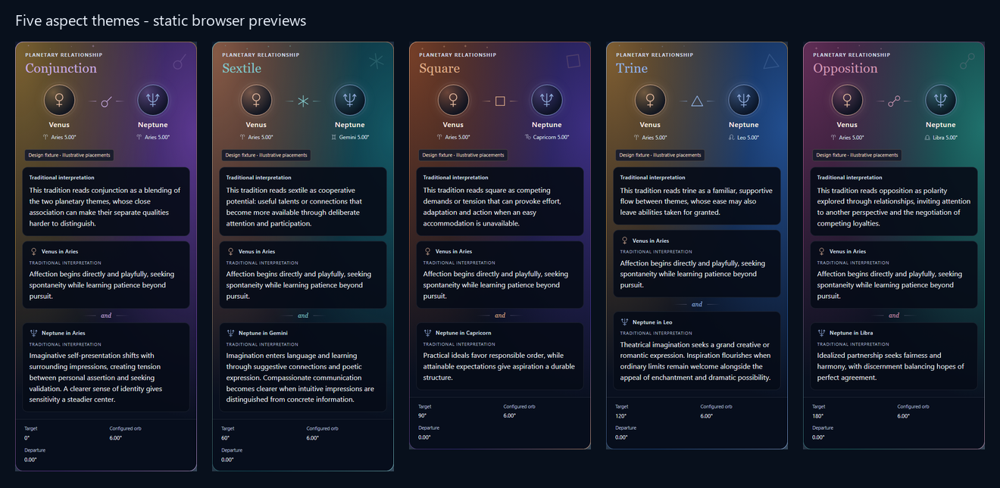
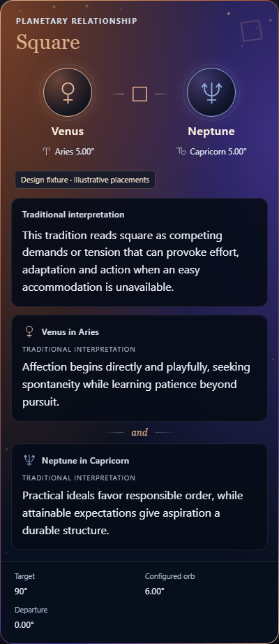
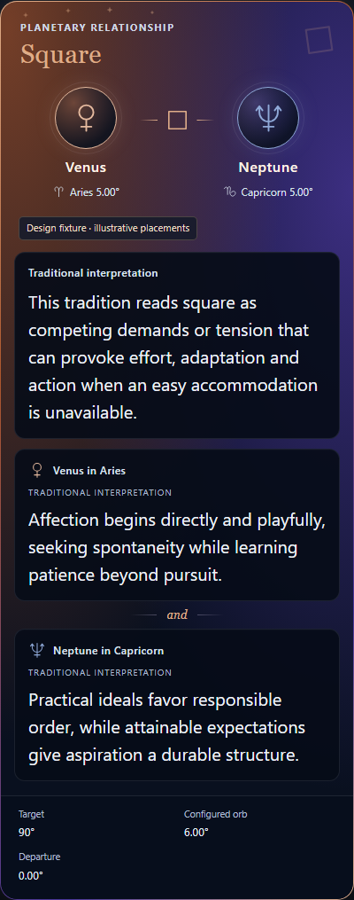

# M10 hover-card design review

Reviewed 26 October 2026 against the approved [M10 plan](../plans/M10-hover-and-earth-projections.md). This report covers the pure resolver, SVG family and actual Svelte card composition. Scene picking, dwell/focus behaviour and geographic rendering are checked separately by the integration browser workflows.

The five themes use the plan’s identity accents and complementary palettes. Colours identify relationship types; they do not encode strength, favourability or an astrological good/bad rating. Each aspect card contains one aspect interpretation and two equally weighted placement sections, with actual body/sign names, body-colour medallions, an SVG relationship glyph, a small “and” connector and a measurement footer. All prose comes from registered claims. Publisher/source details stay in the inspector; the model retains claim IDs, roles and catalogue entry IDs.

## Browser captures

These are Chromium screenshots of `AspectCardPreview.svelte` rendering the production `HoverCard.svelte` component. All positions in this design fixture are explicitly illustrative; they are independent of calculated birth charts. The contact sheet crops and scales the five static browser cards. It does not redraw their contents.

The working Venus-in-Aries / Neptune-in-Capricorn square below is 400 CSS pixels wide with 16px interpretation text. The screenshot freezes an animated composition: the browser reported twelve SVG glints with active CSS animations, bounded 3–6 second cycles and deterministic positions/delays. Text and reading panels do not animate.

The enlarged-text version uses the same 400px card width and 20px interpretation text. Reduced-motion emulation reports zero active glint animations and four visible static glints. The gradients, border, medallions and all interpretation sections remain present.

For complete review captures the preview removes the tooltip’s height cap. Production cards retain their viewport cap and scrollable content; they do not shrink text to fit. At a 400px viewport with enlarged text, the preview produced no horizontal document overflow. Normal, enlarged and reduced-motion captures produced no browser page errors.

## Contrast and system presentation

Contrast was calculated using WCAG sRGB relative luminance against actual screenshot pixels after browser compositing. Five vertical padding samples per reading panel capture its gradient-dependent background; the foreground values come from computed styles. The following values are the minimum sampled body/secondary-label contrast across all three interpretation panels.

| Theme/capture | Body text | Secondary panel text |
|---|---:|---:|
| Conjunction | 16.93:1 | 9.72:1 |
| Sextile | 16.90:1 | 9.76:1 |
| Square | 17.12:1 | 9.82:1 |
| Trine | 16.93:1 | 9.71:1 |
| Opposition | 17.19:1 | 9.82:1 |
| 400px animated square | 17.11:1 | 9.82:1 |
| 400px enlarged/reduced square | 17.11:1 | 9.82:1 |

A separate background-only browser capture sampled the actual text-line rectangles after temporarily making foreground text/SVG transparent. It found a minimum 4.58:1 for small header/footer metadata; 28.8px theme headings meet the large-text 3:1 threshold, with a minimum sampled 3.04:1. These are sampled rendered comparisons, not a claim that every raster pixel or every browser/OS combination was audited. Reading-panel interiors are protected from glints and retain the specified dark 0.92 opacity. The final polish places left header glints in its 8–15px top gutter and remaining header glints in the empty upper-right corner, avoiding the heading/metadata rather than animating over them.

Chromium forced-colours emulation produces Canvas white with CanvasText black for card text, borders and SVG strokes. Decorative sparkle/corner fields are hidden in that mode. The initial check caught pale explicitly coloured SVG strokes; `FeatureGlyph.svelte` now maps them to CanvasText. All icons retain adjacent text names.

## Functional review

The focused domain suite passes 208 tests. It covers all 120 body/sign and 120 body/house combinations; five aspects including out-of-orb dismissal and distinct longitude/sky angles; forty astrocartography body/angle combinations; all 88 region/asterism identities; catalogue/support stars; all seven construction methods’ three registered stages; and all layer-help entries. Every displayed paragraph is checked against the registered catalogue/supplementary texts.

Snapshot identity is explicit. Pending cards retain the calculated instant and show a pending qualification; a requested civil label cannot attach to a retained snapshot. Comparison and Earth-projection IDs stay distinct from their content aliases. Reversed intervals and undefined house results retain their calculation conventions. Trail/history cards use actual stored sample times and reject mismatched observer, frame, system or calculation-version data; they do not substitute current body-in-sign/house prose for historical positions.

`npm run check` completed with zero errors and zero warnings. Targeted ESLint passes. The resolver makes no ephemeris requests, mutates no snapshots and caches spatial-reference metadata per snapshot. Card decoration uses CSS/SVG only, with no added WebGL canvas, particle dependency or scene render-loop request.

The global preview controller was independently inspected read-only. Its dwell, pointer transfer into the card, Escape suppression, resize handling, timer/listener cleanup and restoration of existing `aria-describedby` values are coherent. Two integration items were reported to the owner: provide the combined bright/support-star map, and allow a newly focused target to replace a card while the pointer remains inside the old card. These are integration/controller responsibilities rather than limitations of the card model.
