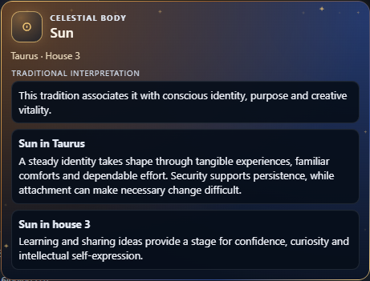
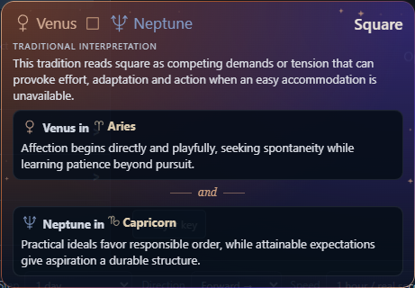
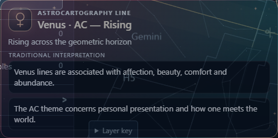

# M10 rectification visual review

26 October 2026. Implements the [approved rectifications](../plans/M10-rectifications.md) on [PR #19](https://github.com/buttery-x3/astrology-viewer/pull/19), based on the unmerged M10 branch. The visual review candidate is `8f86a6b1e0c83f2eda31fa38fa98c22294558369`. Full release validation and M10 integration remain held for the user's visual review.

The user's subsequent correction replaces partial entry presets with [independent per-view layer memory](M10-view-layer-memory.md). That later behavior has its own focused evidence; captures and checks below remain scoped to the candidate recorded above.

## Visible changes

- Outside sphere starts the application with aspects enabled. Explicit Earth/Observer entry disables aspects; Observer enables constellation asterisms. Internal geographic focus preserves manual overrides.
- Relationships use 65% background opacity with an 80% brightness floor and 1.7px ordinary cores; inactive primary/comparison cusps use 22%/25%. Hover and selection retain emphasis.
- Earth entry enables astrocartography and leaves projected house sections disabled. Geographic opacity defaults to 75%; appearance reset preserves layer/filter choices.
- All four geographic categories use equal solid strokes, body colours, repeated angle badges and shared pictograms, with a matching visible key. Precise curve hits take precedence over the transparent margins of their own badges; other badge and overlap identities remain available.
- Every card family has a deliberate colour palette, complementary gradients, illuminated emblem and bounded sparkles. Reduced motion, Low quality, sparkle preferences and hidden-document handling remain respected.
- Hover previews omit the technical fact footer, feature-role implementation labels, routine current-time readout and repeated generic astrocartography introduction. The separate inspector retains full facts, attribution and original claims.
- Cards use 13px standard reading text, smaller headers and tighter spacing. They have no scroll container, F2 transfer or tooltip tab stop. The complete original prose remains present. Measured overflow first expands width, then applies the compact composition; text is not truncated, scaled down or clipped. Reveal uses opacity without translating the content beyond its measured bounds.

## Actual rendered cards

These are installed Chrome 156.0.8078.47 captures of the production component, resolved from the Melbourne regression chart rather than design fixtures. All three normal cards are 460 CSS pixels wide with 13px reading text.

The [capture measurements](M10-rectification-captures.json) record the exact text, viewport bounds, font size and scroll extents. Card heights are 349.36px (Sun), 318.94px (square), and 228.84px (Venus AC). All retain twelve decorative glints in the normal motion-capable composition.

At a 504×450 viewport with the app's Large text setting, reading text grows to 14.625px. The Sun card is 294.33px high and the square is 262px high; both fit completely at 480px width. No horizontal/vertical scrolling or hidden text was observed in these captures. A separate existing 720×600 enlarged-layout case retains 26px reading text and now fits after measured-height compaction.

Full scene captures of Outside with constellation figures/regions, Earth with the geographic key, and Observer with asterisms were also inspected locally. They remain in `.cache/m10-rectification-visuals/` together with constrained captures; only the three isolated card captures above are retained in this report. The [live scene](http://127.0.0.1:5196/) and [expanded design gallery](http://127.0.0.1:5196/#preview=aspects) are available during this local session. Gallery positions are explicitly illustrative and cover the five aspect themes plus nine other feature studies.

## Focused checks and review

- **402 source tests across nine relevant files pass** on the final code candidate: explorer state, aspect renderer, house renderer, Earth projection geometry/renderer, astrocartography, display policy, shared hover resolver and compact preview.
- Final Svelte/TypeScript checking reports **0 errors and 0 warnings**; lint passes for changed source and browser files.
- Content validation passes with the existing **320 entries, 90 sources and 96 canonical page budgets**. Original prose and content registries were not changed.
- Two view-preset/manual-override browser cases passed during the preset package. Three normal card interaction/keyboard/motion cases passed at `3ac71a8`; these are earlier-revision evidence rather than a claim of final full-suite validation.
- The existing actual geographic crossing scenario passes with its full line-role and inspector assertions intact after precise-hit normalization. The enlarged gallery/card case passes after dense layout and stable reveal repairs. Only the failing cases were rerun during those fixes.
- The final installed Chrome capture script checks the actual Sun, square and Venus AC cards plus the two constrained Large-text cards: bounds, complete scroll extents, absence of removed fields, presence of decorative glints and zero page errors.
- Independent source reviews found and resolved the automatic preset leak and incorrect connector title. Final review found no substantive issues in the measured-height layout and geographic hit normalization. This source review does not substitute for full release validation.

The earlier picking-performance confirmation and five external acceptance gates remain open. No full packaged browser matrix, independent release archive rebuild, cold-load probe or stress run was launched for this iteration. Earlier release reports remain scoped to their original revisions.
