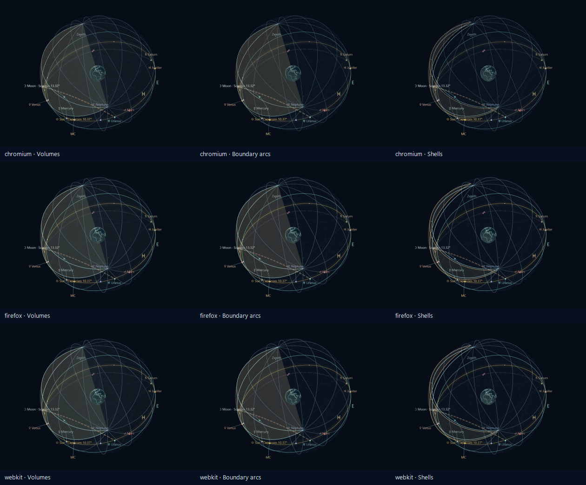

# M9 desktop browser and scene validation

The independently installed production artifact at core commit `e39a1f03c0f847d198ef59ba336789c12e015548` passed the corrected quality and 63-view workflows in all three Playwright engines, plus 42 representative workflows in the installed Chrome and Edge channels. No product renderer change was required for the two browser-test issues described below.

The first full run completed 145/147 workflows. Chromium passed 49/49; Firefox and WebKit each passed 48/49. Both failures were investigated with actual pixel/DPR evidence, corrected in the test harness, and rerun across all three engines: quality 3/3 and matrix 3/3. This records the original failures honestly rather than describing the initial run as 147 passes. Installed-channel validation then passed 21/21 workflows per channel, including source/CSP, Melbourne body identification and local/UTC dates, camera cancellation/recovery, all house displays, constructions, timeline, trails and the complete matrix.

| Browser | Exact tested version | Final focused evidence |
|---|---|---|
| Playwright Chromium |156.0.8078.4|Corrected quality and 63-view matrix pass; initial full suite 49/49|
| Playwright Firefox |157.0|Corrected quality and 63-view matrix pass; other initial workflows 48/48|
| Playwright WebKit |27.2|Corrected quality and 63-view matrix pass; other initial workflows 48/48|
| Installed Chrome |156.0.8078.47|21/21 representative workflows, including 63 views|
| Installed Edge |142.0.3595.94|21/21 representative workflows, including 63 views|

All these runs used a copy of the release installed outside repository ancestors with its own locked production dependencies. The server verified manifest identities and every release asset before listening. Revision, Git tree, source-archive hash, manifest hashes, raw-report hashes, per-project outcomes and quality dimensions are retained in [M9-browser-validation.json](M9-browser-validation.json). The packaged-server and source archive tests exercise the served revision and CSP; the matrix checks stable native body measurements, observer and moment through every display change.

Windows Firefox reported actual DPR1 both at document start and after loading despite Playwright requesting DPR2. Its correct Auto ratio is therefore 1. The quality test now uses `min(actualDPR, qualityCap)` and retains the requested/actual values and backing dimensions. Chromium still explicitly reports DPR2 and verifies Auto1.5, High2 and Low1. The corrected workflow passes all three engines; it does not silently drop HiDPI coverage.

Windows Playwright WebKit's compositor screenshot omitted the accelerated canvas, producing identical navy images for three genuinely different house displays. A synchronous WebGL framebuffer readback proved nonblank, distinct rendered geometry, with GL error0. The final matrix uses a test-only animation wrapper to capture `canvas.toDataURL` immediately after an actual render, before the native animation callback returns. It decodes every saved PNG and requires real non-background pixels and three distinct Outside display frames per system. Production retains `preserveDrawingBuffer=false`. The representative [WebKit compositor image](M9-webkit-compositor.png) remains alongside the actual frame evidence, so the capture limitation is visible.

All five browser configurations passed their 63 combinations: seven systems, three house displays and three viewpoints, for 315 checked actual frames. The lowest sampled frame still contained 54 distinct colours and 417 non-background samples. Per-frame hashes, viewport/graphics context and capture method are in [M9-view-matrix.json](M9-view-matrix.json). Full contact sheets were reviewed for the three engines and installed channels; full-size samples confirmed distinct house geometry, horizon-centred observer views, named body captions and leader placement. No new blocking scene defect was found. The retained [nine-frame sample](M9-matrix-samples.png) shows all three house displays in each Playwright engine; all 315 full-size frames and contact sheets remain in the ignored QA output, whose report hashes are retained.

The ordinary engine run used the reported default graphics backend; Chromium reported SwiftShader. Firefox's generic “GTX980 … or similar” and WebKit's “Apple GPU” strings on Windows do not establish those physical devices. Installed Chrome and Edge reported the actual RTX3060 adapter. Controlled hardware timing and resource evidence is separately documented in [M9-scene-performance.md](M9-scene-performance.md); these functional browser run durations are not performance budgets.

Installed Edge142 is an older available version, not a claim of current or previous-major Edge coverage. Playwright WebKit is not manual Safari on macOS. The plan's integrated-GPU laptop, manual screen-reader and participant acceptance gates remain unverified. These limitations must remain in release acceptance documentation.
